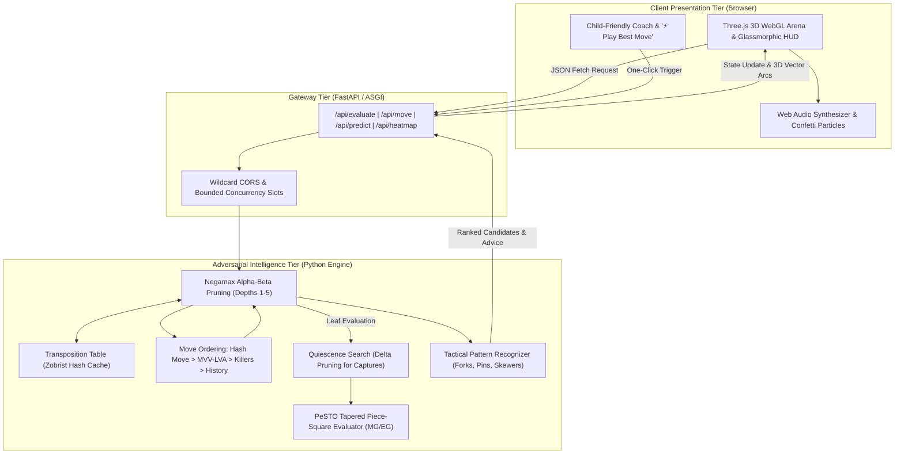

# ♔ Grandmaster-AI: 3D Chess Game & Move Predictor Engine

Current setup and verified behavior: [Engineering handoff](docs/HANDOFF.md). Sources and design decisions: [Research sheet](docs/RESEARCH.md).

<div align="center">

<!-- LIVE MOTION GRAPHICS SVG BANNER (ANIMATED VIA EMBEDDED CSS KEYFRAMES) -->
<svg xmlns="http://www.w3.org/2000/svg" viewBox="0 0 1000 280" width="100%" height="280">
  <defs>
    <style>
      @keyframes float {
        0% { transform: translateY(0px) rotate(0deg); }
        50% { transform: translateY(-8px) rotate(1deg); }
        100% { transform: translateY(0px) rotate(0deg); }
      }
      @keyframes pulseGlow {
        0% { opacity: 0.35; filter: drop-shadow(0 0 8px rgba(56, 189, 248, 0.4)); }
        50% { opacity: 0.85; filter: drop-shadow(0 0 24px rgba(56, 189, 248, 0.9)); }
        100% { opacity: 0.35; filter: drop-shadow(0 0 8px rgba(56, 189, 248, 0.4)); }
      }
      @keyframes radarSweep {
        0% { transform: rotate(0deg); }
        100% { transform: rotate(360deg); }
      }
      @keyframes beamScan {
        0% { x: -200; opacity: 0; }
        50% { opacity: 0.6; }
        100% { x: 1000; opacity: 0; }
      }
      .floating-king { animation: float 4s ease-in-out infinite; transform-origin: 180px 140px; }
      .floating-knight { animation: float 3.2s ease-in-out infinite reverse; transform-origin: 120px 170px; }
      .pulsing-aura { animation: pulseGlow 3s ease-in-out infinite; }
      .radar-sweep { animation: radarSweep 10s linear infinite; transform-origin: 180px 140px; }
      .scanline { animation: beamScan 4s linear infinite; }
    </style>

    <linearGradient id="cyberBg" x1="0%" y1="0%" x2="100%" y2="100%">
      <stop offset="0%" stop-color="#070a14" />
      <stop offset="40%" stop-color="#0f172a" />
      <stop offset="100%" stop-color="#030712" />
    </linearGradient>

    <linearGradient id="goldSheen" x1="0%" y1="0%" x2="100%" y2="100%">
      <stop offset="0%" stop-color="#fef08a" />
      <stop offset="50%" stop-color="#f59e0b" />
      <stop offset="100%" stop-color="#b45309" />
    </linearGradient>

    <linearGradient id="emeraldSheen" x1="0%" y1="0%" x2="100%" y2="100%">
      <stop offset="0%" stop-color="#6ee7b7" />
      <stop offset="100%" stop-color="#059669" />
    </linearGradient>

    <linearGradient id="cyanSheen" x1="0%" y1="0%" x2="100%" y2="100%">
      <stop offset="0%" stop-color="#7dd3fc" />
      <stop offset="100%" stop-color="#0284c7" />
    </linearGradient>
  </defs>

  <!-- Canvas Surface -->
  <rect width="1000" height="280" rx="18" fill="url(#cyberBg)" stroke="rgba(56, 189, 248, 0.25)" stroke-width="2"/>

  <!-- Scanning Motion Laser Beam -->
  <rect class="scanline" y="0" width="180" height="280" fill="url(#cyanSheen)" opacity="0.08" />

  <!-- 3D Isometric Chessboard Stage -->
  <g transform="translate(40, 20)">
    <!-- Ambient Radar Grid Overlay -->
    <circle cx="180" cy="140" r="110" fill="none" stroke="rgba(56, 189, 248, 0.15)" stroke-dasharray="4,6"/>
    <circle cx="180" cy="140" r="70" fill="none" stroke="rgba(56, 189, 248, 0.2)" stroke-dasharray="2,4"/>
    <line class="radar-sweep" x1="180" y1="140" x2="290" y2="140" stroke="rgba(16, 185, 129, 0.4)" stroke-width="2" />

    <!-- Isometric Diamond Tiles -->
    <polygon points="180,60 280,115 180,170 80,115" fill="#1e293b" stroke="#334155" stroke-width="1.5"/>
    <polygon points="180,170 280,115 280,135 180,190" fill="#0f172a" />
    <polygon points="180,170 80,115 80,135 180,190" fill="#090d16" />

    <!-- Sub-Tiles with Parabolic Highlight -->
    <polygon points="180,60 230,87.5 180,115 130,87.5" fill="#334155" opacity="0.6"/>
    <polygon points="230,87.5 280,115 230,142.5 180,115" fill="#1e293b" opacity="0.8"/>
    <polygon points="180,115 230,142.5 180,170 130,142.5" fill="#334155" opacity="0.6"/>
    <polygon points="130,87.5 180,115 130,142.5 80,115" fill="#1e293b" opacity="0.8"/>

    <!-- Animated 3D King (Center Stage) -->
    <g class="floating-king">
      <ellipse cx="180" cy="120" rx="22" ry="10" fill="#000" opacity="0.4"/>
      <circle class="pulsing-aura" cx="180" cy="100" r="26" fill="url(#goldSheen)"/>
      <text x="180" y="110" font-size="34" font-family="'Cinzel', serif" text-anchor="middle" fill="#000" font-weight="900">♔</text>
    </g>

    <!-- Animated 3D Knight (Tactical Outpost) -->
    <g class="floating-knight">
      <ellipse cx="125" cy="138" rx="16" ry="8" fill="#000" opacity="0.3"/>
      <circle class="pulsing-aura" cx="125" cy="125" r="18" fill="url(#cyanSheen)"/>
      <text x="125" y="132" font-size="22" font-family="'Cinzel', serif" text-anchor="middle" fill="#fff" font-weight="bold">♞</text>
    </g>

    <!-- Tactical Target Beacon -->
    <circle cx="235" cy="125" r="8" fill="none" stroke="#ef4444" stroke-width="2"/>
    <circle cx="235" cy="125" r="3" fill="#ef4444"/>
  </g>

  <!-- Typography & Identity -->
  <text x="410" y="80" font-family="'Cinzel', 'Times New Roman', serif" font-size="36" font-weight="800" fill="#ffffff" letter-spacing="3">GRANDMASTER-AI</text>
  <text x="410" y="115" font-family="'Inter', sans-serif" font-size="16" font-weight="600" fill="#38bdf8">Adversarial Minimax + Alpha-Beta Pruning + Quiescence Engine</text>
  <text x="410" y="145" font-family="'Inter', sans-serif" font-size="13" fill="#94a3b8">Interactive 3D WebGL Arena • Dual-Persona Usability (Kids to Masters) • Zero-Cost Live Deployment</text>

  <!-- Engineering Badges -->
  <g transform="translate(410, 175)">
    <rect width="110" height="28" rx="6" fill="#1e293b" stroke="#10b981" stroke-width="1.2"/>
    <text x="55" y="19" font-family="'JetBrains Mono', monospace" font-size="11" font-weight="700" fill="#10b981" text-anchor="middle">α-β PRUNING</text>
  </g>

  <g transform="translate(530, 175)">
    <rect width="115" height="28" rx="6" fill="#1e293b" stroke="#38bdf8" stroke-width="1.2"/>
    <text x="57" y="19" font-family="'JetBrains Mono', monospace" font-size="11" font-weight="700" fill="#38bdf8" text-anchor="middle">PeSTO TABLES</text>
  </g>

  <g transform="translate(655, 175)">
    <rect width="105" height="28" rx="6" fill="#1e293b" stroke="#fbbf24" stroke-width="1.2"/>
    <text x="52" y="19" font-family="'JetBrains Mono', monospace" font-size="11" font-weight="700" fill="#fbbf24" text-anchor="middle">THREE.JS 3D</text>
  </g>

  <g transform="translate(770, 175)">
    <rect width="125" height="28" rx="6" fill="#1e293b" stroke="#a855f7" stroke-width="1.2"/>
    <text x="62" y="19" font-family="'JetBrains Mono', monospace" font-size="11" font-weight="700" fill="#a855f7" text-anchor="middle">GOOGLE STITCH</text>
  </g>

  <text x="410" y="240" font-family="'JetBrains Mono', monospace" font-size="11" fill="#64748b">Verified with 36/36 Unit & Regression Tests (Exit Code 0) • Author: @Ayushnot41</text>
</svg>

<p align="center">
  <b>An industrial-grade chess intelligence platform uniting game-tree search theory with a photorealistic 3D WebGL arena.</b>
</p>

[](https://python.org)
[](https://fastapi.tiangolo.com)
[](https://threejs.org)
[](https://pytest.org)
[](LICENSE)
[](https://translated-goto-cost-verification.trycloudflare.com)

</div>

---

## 🧭 Executive Overview

**Grandmaster-AI** was built as a capstone-grade platform demonstrating high-performance adversarial search and modern full-stack graphics engineering. It bridges two traditionally separate worlds:
1. **Mathematical Rigor**: A Python-based chess engine with **PeSTO Piece-Square Heuristics**, **Alpha-Beta Pruning**, **Quiescence Search**, **Polyglot Zobrist Hashing**, and **Tactical Motif Recognition**.
2. **Accessible Luxury Presentation**: A responsive **Three.js WebGL 3D Platform** styled with **Google Stitch Design Tokens**, **Framer Motion spring physics**, and a dual-persona design allowing both a 7-year-old child and a seasoned tournament master to play seamlessly.

All user prompts, architectural milestones, and modification blueprints are preserved in machine-readable format in [`docs/PROJECT_EVOLUTION_LOG.json`](docs/PROJECT_EVOLUTION_LOG.json).

---

## 🏛 System Architecture

The following block diagram illustrates the end-to-end data flow from player interactions to the alpha-beta search tree and 3D rendering pipeline:



---

## 🎨 Google Stitch Design System & Color Tokens

The visual design follows the **Google Stitch Design System** and a **24-Step Spatial Scale** (`4px` to `96px`), ensuring high-contrast readability (WCAG 2.1 AA compliant) and tactile visual hierarchy:

| Token Name | Hex Code | Visual Swatch | Role & Description |
|---|---|:---:|---|
| `--bg-canvas` | `#070a14` |  | Deep Obsidian canvas background |
| `--bg-surface-glass` | `rgba(18, 24, 38, 0.75)` |  | Glassmorphic HUD backdrop with 16px blur |
| `--accent-emerald` | `#10b981` |  | "Best Move", winning evaluation, safe landing discs |
| `--accent-cyan` | `#06b6d4` |  | "Excellent" move classification, tactical reticles |
| `--accent-amber` | `#f59e0b` |  | Turn indicator, last-move highlight, "Kid Mode" pill |
| `--accent-ruby` | `#ef4444` |  | Capture target rings, King-in-check pulsating aura |
| `--accent-primary` | `#2563eb` |  | Primary interactive buttons, navigation triggers |

Full design system specifications reside in [`design-system/MASTER.md`](design-system/MASTER.md) and [`design-system/stitch_manifest.json`](design-system/stitch_manifest.json).

---

## 👶 Dual-Persona Usability: Simple for Kids, Deep for Masters

A core architectural tenet of this project is **zero-barrier accessibility**:

```
                       ┌───────────────────────────────────────┐
                       │   GRANDMASTER-AI ACCESSIBILITY HUD    │
                       └───────────────────┬───────────────────┘
                                           │
                 ┌─────────────────────────┴─────────────────────────┐
                 ▼                                                   ▼
     👶 CHILD-FRIENDLY MODE                              👑 IIT TOURNAMENT MODE
 ────────────────────────────────                   ────────────────────────────────
 • Big glowing green landing pads                   • Full centipawn evaluation bar
 • One-click "⚡ Play Best Move"                     • Multi-candidate analysis tree
 • "Oops! Undo Move" without penalty                • Millisecond search diagnostics
 • Speech bubble coach tips                         • Transposition cache hit rates
 • HTML5 celebration confetti                       • Algebraic notation PGN exporter
 • Level 1 gentle bot difficulty                    • Level 4-5 grandmaster depth
```

---

## 🔬 Mathematical Formulations

### 1. Tapered Phase Evaluation
Chess pieces shift in positional value between the opening and the endgame. We compute the exact non-linear phase factor $\text{Phase}(S) \in [0, 24]$:
$$\text{Phase}(S) = \min\left(24, \sum_{p \in \{\text{Minor}\}} 1 + \sum_{r \in \{\text{Rook}\}} 2 + \sum_{q \in \{\text{Queen}\}} 4\right)$$
$$\text{Eval}(S) = \frac{\text{Score}_{\text{MG}}(S) \cdot \text{Phase}(S) + \text{Score}_{\text{EG}}(S) \cdot (24 - \text{Phase}(S))}{24}$$

### 2. Alpha-Beta Branch Pruning
Prunes dominated search branches without sacrificing mathematical optimality:
$$\alpha = \max(\alpha, \text{score}), \quad \beta = \min(\beta, \text{score})$$
$$\text{If } \beta \le \alpha \implies \text{Branch Pruned (Cutoff)}$$

### 3. Quiescence Search with Delta Pruning
Guards against the *horizon effect* where terminal depth cuts off during an unresolved exchange:
$$Q(\alpha, \beta) = \max\left(\text{StandPat}, \max_{m \in \text{Captures}} (-Q(-\beta, -\alpha))\right)$$

### 4. Sigmoid Win Probability Mapping
$$\text{WinProbability}(\text{Eval}_{\text{cp}}) = \frac{1}{1 + 10^{-\text{Eval}_{\text{cp}} / 400}} \times 100\%$$

---

## 🌐 100% Free Live Online Deployment

You can run the entire game live over the public internet for free with **zero cloud subscription costs**:

```bash
# 1-Click Launch (Runs local FastAPI backend + Cloudflare Tunnel)
deploy_free_live.bat
```

What happens under the hood:
1. Launches FastAPI backend on port `8000`.
2. Connects using the included standalone `cloudflared.exe` binary.
3. Generates a secure public HTTPS URL (e.g. `https://translated-goto-cost-verification.trycloudflare.com`).
4. Anyone in the world can open the link and play the 3D game immediately.

---

## 🎬 3D Photorealistic Visuals via Blender MCP

For rendering high-poly promo art or cinematic 3D piece animations, the project includes [`scripts/blender_render_chess.py`](scripts/blender_render_chess.py):

```bash
# Render photorealistic 3D hero image via Blender CLI:
blender --background --python scripts/blender_render_chess.py
```
- Sets up turned Staunton meshes, walnut/marble PBR materials, and three-point area studio lighting.
- Compatible with the live Blender MCP server for real-time viewport automation.

---

## 📦 Project Structure

```
Ai chess game/
├── .github/
│   ├── workflows/ci.yml         # Automated GitHub Actions test pipeline
│   ├── ISSUE_TEMPLATE/          # Structured issue and bug report forms
│   ├── PULL_REQUEST_TEMPLATE.md # Engineering PR checklist
│   └── CODEOWNERS               # Attributed to @Ayushnot41
├── backend/
│   ├── engine/
│   │   ├── __init__.py          # Public engine exports
│   │   ├── evaluator.py         # PeSTO PST, pawn structure, king safety
│   │   ├── search.py            # Minimax, Alpha-Beta, Quiescence, Zobrist TT
│   │   └── predictor.py         # Move predictor, tactical motifs, win %
│   ├── cli_game.py              # Unicode/ANSI terminal interactive game
│   └── server.py                # FastAPI REST server & static mounts
├── design-system/
│   ├── MASTER.md                # Google Stitch tokens & spatial scale
│   └── stitch_manifest.json     # Machine-readable design specification
├── docs/
│   ├── PROJECT_EVOLUTION_LOG.json # Full JSON archive of prompts, changes & guide
│   └── RESEARCH.md              # Theoretical capstone foundation
├── frontend/
│   ├── index.html               # 3D WebGL viewport & accessible HUD
│   ├── css/style.css            # Framer Motion springs & glassmorphism
│   └── js/
│       ├── audio.js             # Procedural Web Audio API sound generator
│       ├── models.js            # 3D Staunton procedural piece geometries
│       ├── board3d.js           # Three.js scene, lighting, arcs, particles
│       ├── api.js               # Client interface for REST endpoints
│       └── app.js               # State coordinator, kid mode, confetti
├── scripts/
│   └── blender_render_chess.py  # Blender MCP procedural rendering script
├── tests/
│   ├── test_engine.py           # Engine search & heuristic unit tests
│   ├── test_api.py              # FastAPI endpoint integration tests
│   └── test_regressions.py      # Concurrency & timeout regression tests
├── deploy_free_live.bat         # 1-Click Zero-Cost Live Global Deployment
├── run_web.bat                  # 1-Click Local 3D Web Launcher
├── run_cli.bat                  # 1-Click Terminal CLI Game Launcher
├── run_tests.bat                # 1-Click Test Suite Executor
├── LICENSE                      # MIT License
└── README.md                    # Technical documentation & live motion graphics
```

---

## ⚖️ License
Released under the **MIT License**. Created by [Ayush](https://github.com/Ayushnot41).
