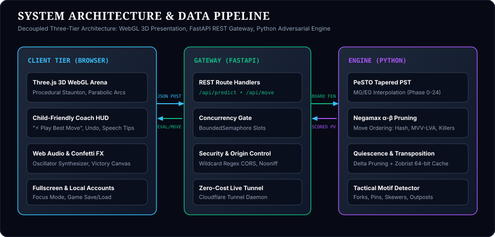
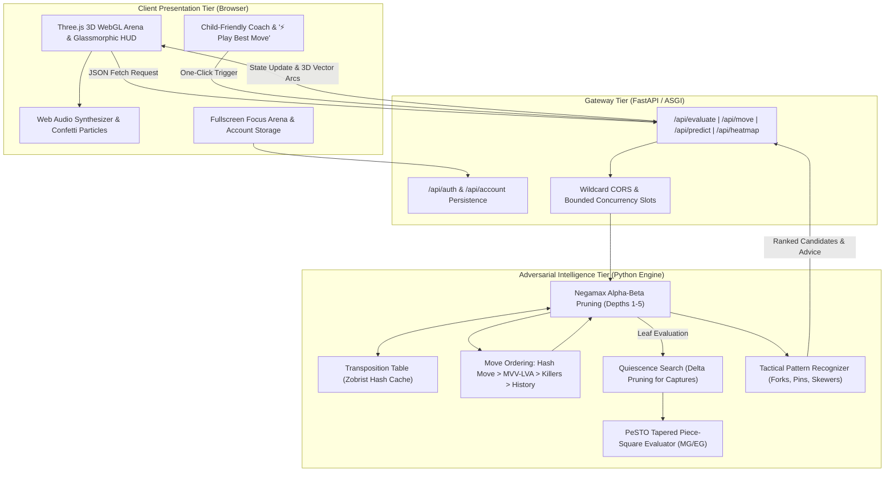
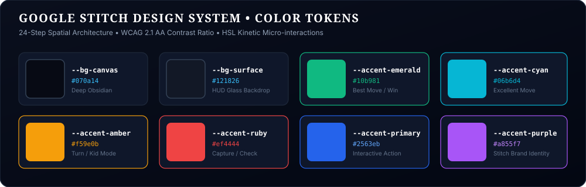

# ♔ Grandmaster-AI: 3D Chess Game & Move Predictor Engine

Current setup and verified behavior: [Engineering handoff](docs/HANDOFF.md). Sources and design decisions: [Research sheet](docs/RESEARCH.md).

<div align="center">

<!-- LIVE 3D MOTION GRAPHICS BANNER (AUTOPLAYING CSS KEYFRAMES VIA STANDALONE SVG) -->
<a href="https://translated-goto-cost-verification.trycloudflare.com">
  
</a>

<p align="center">
  <b>An industrial-grade chess intelligence platform uniting game-tree search theory with a photorealistic 3D WebGL arena.</b>
</p>

[](https://python.org)
[](https://fastapi.tiangolo.com)
[](https://threejs.org)
[](https://pytest.org)
[](https://vercel.com/new/clone?repository-url=https%3A%2F%2Fgithub.com%2FAyushnot41%2FAi-chess-game)
[](LICENSE)
[](https://translated-goto-cost-verification.trycloudflare.com)

</div>

---

## 🧭 Executive Overview

**Grandmaster-AI** was built as a capstone-grade platform demonstrating high-performance adversarial search and modern full-stack graphics engineering. It bridges two traditionally separate worlds:
1. **Mathematical Rigor**: A Python-based chess engine with **PeSTO Piece-Square Heuristics**, **Alpha-Beta Pruning**, **Quiescence Search**, **Polyglot Zobrist Hashing**, and **Tactical Motif Recognition**.
2. **Accessible Luxury Presentation**: A responsive **Three.js WebGL 3D Platform** styled with **Google Stitch Design Tokens**, **Framer Motion spring physics**, and a dual-persona design allowing both a 7-year-old child and a seasoned tournament master to play seamlessly.

All user prompts, architectural milestones, and modification blueprints are preserved in machine-readable format in [`docs/PROJECT_EVOLUTION_LOG.json`](docs/PROJECT_EVOLUTION_LOG.json).

---

## 🚀 Deploy as a Single Live Link on Vercel (100% Free)

You can host both the **Three.js 3D WebGL Frontend** and the **FastAPI AI Python Engine** under **ONE SINGLE PERMANENT LINK** (e.g. `https://ai-chess-game.vercel.app`) with zero cost on Vercel's free global tier.

### Method 1: Instant 1-Click Web Deployment (Easiest)
1. Click the official Vercel deploy button:
   [](https://vercel.com/new/clone?repository-url=https%3A%2F%2Fgithub.com%2FAyushnot41%2FAi-chess-game)
2. Log in with your GitHub account (`Ayushnot41`).
3. Click **Deploy**. Vercel reads [`vercel.json`](vercel.json) and [`api/index.py`](api/index.py), sets up the Python serverless runtime, and serves the 3D frontend.
4. Your permanent single link is created instantly with a free SSL certificate!

### Method 2: 1-Command PowerShell Deployment
You already have Vercel CLI installed on your machine. Simply run:
```powershell
vercel --prod
```
- Press Enter to confirm defaults.
- Vercel automatically uploads the project and prints your unified live link directly in PowerShell!

---

## 🏛 System Architecture

The following block diagram illustrates the end-to-end data flow from player interactions to the alpha-beta search tree and 3D rendering pipeline:

<p align="center">
  
</p>



---

## 🎨 Google Stitch Design System & Color Tokens

The visual design follows the **Google Stitch Design System** and a **24-Step Spatial Scale** (`4px` to `96px`), ensuring high-contrast readability (WCAG 2.1 AA compliant) and tactile visual hierarchy:

<p align="center">
  
</p>

| Token Name | Hex Code | Visual Swatch | Role & Description |
|---|---|:---:|---|
| `--bg-canvas` | `#070a14` |  | Deep Obsidian canvas background |
| `--bg-surface-glass` | `#121826` |  | Glassmorphic HUD backdrop with 16px blur |
| `--accent-emerald` | `#10b981` |  | "Best Move", winning evaluation, safe landing discs |
| `--accent-cyan` | `#06b6d4` |  | "Excellent" move classification, tactical reticles |
| `--accent-amber` | `#f59e0b` |  | Turn indicator, last-move highlight, "Kid Mode" pill |
| `--accent-ruby` | `#ef4444` |  | Capture target rings, King-in-check pulsating aura |
| `--accent-primary` | `#2563eb` |  | Primary interactive buttons, navigation triggers |

Full design system specifications reside in [`design-system/MASTER.md`](design-system/MASTER.md) and [`design-system/stitch_manifest.json`](design-system/stitch_manifest.json).

---

## 👶 Dual-Persona Usability: Simple for Kids, Deep for Masters

A core architectural tenet of this project is **zero-barrier accessibility**:

```
                       ┌───────────────────────────────────────┐
                       │   GRANDMASTER-AI ACCESSIBILITY HUD    │
                       └───────────────────┬───────────────────┘
                                           │
                 ┌─────────────────────────┴─────────────────────────┐
                 ▼                                                   ▼
     👶 CHILD-FRIENDLY MODE                              👑 IIT TOURNAMENT MODE
 ────────────────────────────────                   ────────────────────────────────
 • Big glowing green landing pads                   • Full centipawn evaluation bar
 • One-click "⚡ Play Best Move"                     • Multi-candidate analysis tree
 • "Oops! Undo Move" without penalty                • Millisecond search diagnostics
 • Speech bubble coach tips                         • Transposition cache hit rates
 • HTML5 celebration confetti                       • Algebraic notation PGN exporter
 • Level 1 gentle bot difficulty                    • Level 4-5 grandmaster depth
```

---

## 🔬 Mathematical Formulations

### 1. Tapered Phase Evaluation
Chess pieces shift in positional value between the opening and the endgame. We compute the exact non-linear phase factor $\text{Phase}(S) \in [0, 24]$:
$$\text{Phase}(S) = \min\left(24, \sum_{p \in \{\text{Minor}\}} 1 + \sum_{r \in \{\text{Rook}\}} 2 + \sum_{q \in \{\text{Queen}\}} 4\right)$$
$$\text{Eval}(S) = \frac{\text{Score}_{\text{MG}}(S) \cdot \text{Phase}(S) + \text{Score}_{\text{EG}}(S) \cdot (24 - \text{Phase}(S))}{24}$$

### 2. Alpha-Beta Branch Pruning
Prunes dominated search branches without sacrificing mathematical optimality:
$$\alpha = \max(\alpha, \text{score}), \quad \beta = \min(\beta, \text{score})$$
$$\text{If } \beta \le \alpha \implies \text{Branch Pruned (Cutoff)}$$

### 3. Quiescence Search with Delta Pruning
Guards against the *horizon effect* where terminal depth cuts off during an unresolved exchange:
$$Q(\alpha, \beta) = \max\left(\text{StandPat}, \max_{m \in \text{Captures}} (-Q(-\beta, -\alpha))\right)$$

### 4. Sigmoid Win Probability Mapping
$$\text{WinProbability}(\text{Eval}_{\text{cp}}) = \frac{1}{1 + 10^{-\text{Eval}_{\text{cp}} / 400}} \times 100\%$$

---

## 🌐 Alternative 1-Click Free Local Live Tunnel

You can also run the game live directly from your laptop without cloud hosting using the included Cloudflare Tunnel launcher:

```bash
# 1-Click Launch (Runs local FastAPI backend + Cloudflare Tunnel)
deploy_free_live.bat
```

What happens under the hood:
1. Launches FastAPI backend on port `8000`.
2. Connects using the included standalone `cloudflared.exe` binary.
3. Generates a secure public HTTPS URL (e.g. `https://translated-goto-cost-verification.trycloudflare.com`).
4. Anyone in the world can open the link and play the 3D game immediately.

---

## 🎬 3D Photorealistic Visuals via Blender MCP

For rendering high-poly promo art or cinematic 3D piece animations, the project includes [`scripts/blender_render_chess.py`](scripts/blender_render_chess.py):

```bash
# Render photorealistic 3D hero image via Blender CLI:
blender --background --python scripts/blender_render_chess.py
```
- Sets up turned Staunton meshes, walnut/marble PBR materials, and three-point area studio lighting.
- Compatible with the live Blender MCP server for real-time viewport automation.

---

## 📦 Project Structure

```
Ai chess game/
├── .github/
│   ├── workflows/ci.yml         # Automated GitHub Actions test pipeline
│   ├── ISSUE_TEMPLATE/          # Structured issue and bug report forms
│   ├── PULL_REQUEST_TEMPLATE.md # Engineering PR checklist
│   └── CODEOWNERS               # Attributed to @Ayushnot41
├── api/
│   └── index.py                 # Vercel Serverless Function entrypoint (FastAPI)
├── assets/
│   ├── hero-3d-motion.svg       # Standalone 3D animated motion graphic banner
│   ├── stitch-palette.svg       # Google Stitch design tokens visual palette
│   ├── architecture-diagram.svg # Three-tier system architecture vector chart
│   └── swatch-*.svg             # Native GitHub-compatible color chips
├── backend/
│   ├── engine/
│   │   ├── __init__.py          # Public engine exports
│   │   ├── evaluator.py         # PeSTO PST, pawn structure, king safety
│   │   ├── search.py            # Minimax, Alpha-Beta, Quiescence, Zobrist TT
│   │   └── predictor.py         # Move predictor, tactical motifs, win %
│   ├── accounts.py              # User profiles, auth and saved game endpoints
│   ├── database.py              # SQLite / PostgreSQL persistence engine
│   ├── cli_game.py              # Unicode/ANSI terminal interactive game
│   └── server.py                # FastAPI REST server & static mounts
├── design-system/
│   ├── MASTER.md                # Google Stitch tokens & spatial scale
│   └── stitch_manifest.json     # Machine-readable design specification
├── docs/
│   ├── PROJECT_EVOLUTION_LOG.json # Full JSON archive of prompts, changes & guide
│   ├── RESEARCH.md              # Theoretical capstone foundation
│   └── HANDOFF.md               # Operational handoff & verification report
├── frontend/
│   ├── index.html               # 3D WebGL viewport & accessible HUD
│   ├── css/style.css            # Framer Motion springs & glassmorphism
│   ├── css/play.css             # Fullscreen focus & board layout rules
│   └── js/
│       ├── audio.js             # Procedural Web Audio API sound generator
│       ├── models.js            # 3D Staunton procedural piece geometries
│       ├── materials.js         # PBR physically based rendering shaders
│       ├── board3d.js           # Three.js scene, lighting, arcs, particles
│       ├── api.js               # Client interface for REST endpoints
│       ├── fullscreen.js        # Fullscreen distraction-free arena mode
│       ├── accounts.js          # Cloud/local game save and load manager
│       └── app.js               # State coordinator, kid mode, confetti
├── scripts/
│   └── blender_render_chess.py  # Blender MCP procedural rendering script
├── tests/
│   ├── test_engine.py           # Engine search & heuristic unit tests
│   ├── test_api.py              # FastAPI endpoint integration tests
│   ├── test_regressions.py      # Concurrency & timeout regression tests
│   └── test_accounts.py         # Account persistence & save tests
├── deploy_free_live.bat         # 1-Click Zero-Cost Live Global Deployment
├── run_web.bat                  # 1-Click Local 3D Web Launcher
├── run_cli.bat                  # 1-Click Terminal CLI Game Launcher
├── run_tests.bat                # 1-Click Test Suite Executor
├── vercel.json                  # Unified Single-Link Vercel deployment manifest
├── render.yaml                  # Alternative Render.com cloud manifest
├── LICENSE                      # MIT License
└── README.md                    # Technical documentation & live motion graphics
```

---

## ⚖️ License
Released under the **MIT License**. Created by [Ayush](https://github.com/Ayushnot41).
